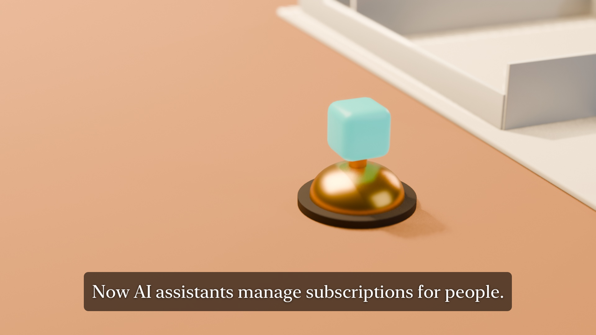

# Kept

**Fair PayPal subscriptions that people, shops and AI assistants can all manage.**

**Live demo: https://pph-kept.onrender.com**. Press **Start the guided demo** for an 8-minute guided story. There's no sign-up, and you get your own private copy of the demo shop.

Built for the PayPal AI Hackathon, on the **PayPal sandbox**: real PayPal calls, test money. MIT licence.



---

## Overview

Subscriptions are easy to start and hard to leave. That hurts the people who pay, and it hurts the small shops who rely on them, because trust is the only retention a small shop can afford. A third party is now arriving: AI assistants that will skip, pause and cancel subscriptions for people.

Kept sits on top of **PayPal Subscriptions** for small subscription businesses (a coffee club, a meal-prep kitchen, a farm box), and serves three people:

- **The member** can skip, pause, switch or cancel in one step, from a page that needs no app and no password, or from a Telegram reminder.
- **The owner** writes the shop's rules in plain words. Kept turns them into limits that code enforces, refuses rules that break consumer law, and asks the owner before any money move above those limits.
- **The member's AI assistant** gets a signed permission slip for exactly one request, valid for 15 minutes, and acts through Kept's MCP server. It never gets the member's login.

Every change goes to PayPal first and is **read back from PayPal** before anyone is told it's done. **Code decides every money move; AI models only read, choose among options code allows, or word things.**

### The problem we solved

> Small subscription shops lose customers to the same dark patterns that make cancelling hard. Members pay for things they forgot. AI assistants are about to manage subscriptions with no safe way to act for a person. Kept solves this with one-step changes that PayPal confirms, owner rules enforced in code, signed single-request permissions for AI assistants, and a scam model trained by us that runs entirely in the browser.

The numbers behind it, each linked on the landing page:

| Figure | Source |
|---|---|
| **76%** of 642 subscription sites and apps used at least one possible dark pattern | [FTC, July 2024](https://www.ftc.gov/news-events/news/press-releases/2024/07/ftc-icpen-gpen-announce-results-review-use-dark-patterns-affecting-subscription-services-privacy) |
| **~70 a day**: complaints to the FTC about hard-to-cancel subscriptions in 2024, up from 42 a day in 2021 | FTC, October 2024 |
| **$219 a month** spent on subscriptions by people who guessed they spent $86 | C+R Research |
| **+693%** traffic from generative-AI tools to US retail sites in the 2025 holidays | Adobe, January 2026 |
| **$2.77 billion** reported lost to business email compromise in 2024 (the fake "new account" message) | FBI IC3 2024 |

### Technical depth in one paragraph

Kept calls PayPal's Subscriptions API across the whole lifecycle: create, get, suspend, activate, revise, cancel and capture. It also uses billing plans, catalog products, subscription transactions, signature-verified webhooks, the JavaScript SDK buttons and **PayPal's own MCP server**. A single executor is the only code that writes to PayPal, with a `PayPal-Request-Id` on every write and a read-back after it. The AI runs on two levels:

- **On the server:** OpenAI agents with tools (`gpt-6.1-sol`), the OpenAI **Decisions API** for yes/no checks, and `gpt-live-1` push-to-talk.
- **On the device:** a **MiniLM scam model we fine-tuned and quantised to 23 MB** (ONNX Runtime Web), a LightGBM payment-risk model, and MediaPipe face tracking for hands-free use.

Kept runs its own **MCP server** with 14 tools for any AI assistant, plus 9 read-only tools for the owner's agent. It is checked by 223 server tests, 29 browser tests (each on phone and desktop, with axe accessibility checks) and a robot judge that walks the live site. The robot judge passed 15 of 15 on 13 Nov 2026.

---

## Judging criteria: why Kept deserves to win

### Technological implementation

- **PayPal, end to end and live:**
  - Subscriptions from create to cancel and capture
  - billing plans and catalog products
  - subscription transactions for the daily reconcile
  - webhooks with signature verification (unsigned events are stored, never acted on)
  - JS SDK subscription buttons
  - **PayPal's MCP server** (`mcp.sandbox.paypal.com`) as a read tool for the owner's AI agent
  - **`/paypal`** lists each API with its latest sandbox id.
- **Money is moved by code, never by a model.** One executor writes to PayPal; models can't call it (`/who-can-move-money`). Offers are computed deterministically from the approved rules (`src/policy/eligibility.ts`). The model may only pick one of those offers and word it.
- **Read-back, not trust.** Kept only shows "done" after PayPal returns the new state. A daily re-read and PayPal webhooks keep Kept and PayPal in step.
- **AI with receipts.** The owner's Ask cites a fact for every sentence. `/ai` shows the last 20 model calls with inputs, tools, outputs, time and cost. `/proof` shows every evaluation case.
- **A model trained by us, running on the device.** See [the local scam model](#the-local-scam-model-trained-by-us-runs-in-your-browser) below.
- **Production shape on Render:** a web service, a background worker, a daily cron job and Postgres, from one `render.yaml`. Idempotent job queue, rate limits, idle-shop expiry that cancels each real sandbox subscription and reads it back.

### Design

- **One story for three people.** The guided tour hands over between the owner, the member and the member's AI assistant, each in their own colour. It outlines the part of the page each step is about and never covers it. Each step shows small tags for what it really uses.
- **No app, no password** for members: the link in every reminder opens their page. Each circle on the stamp card is one PayPal payment.
- **Accessible by default:** WCAG 2.2 AA checked by axe on phone and desktop, a "Display and help" panel, hands-free use, and four languages. See [Accessibility](#accessibility).
- **Show, don't tell:** a hero illustration you can press, live PayPal ids, and proof pages instead of claims.

### Potential impact

- **Fair by default.** One-step cancel for every member. At most one offer, and only if the member asks. No discount in exchange for a quality complaint. A rule that breaks consumer law (ROSCA, California's automatic renewal law) is refused, with the law it breaks.
- **For the shops that need it most.** Small subscription businesses get retention without traps: reminders before each payment, fair offers within limits the owner set, and owner approval above them.
- **For people other sites leave out:** people who can't use a mouse (hands-free mode), people who read better in their own language (Hindi, Indonesian, Portuguese), and people targeted by payment scams (the in-browser check).
- **Ready for AI assistants** before they arrive at scale, with permissions narrow enough to trust.

### Innovation

- **Signed, single-request permissions for AI assistants.** That's agentic commerce without handing over a login. Every tool call is logged with the rule that allowed it.
- **Rules in plain words become code.** Unlawful rules are refused, and every money move above the owner's limits waits for an Approve or Decline, on the dashboard or in Telegram.
- **A scam model that never sends the message anywhere.** It's fine-tuned by us, quantised to 23 MB and run with ONNX Runtime Web. It's one of three independent checks, alongside rules and OpenAI Decisions.
- **Hands-free subscription management** ("Look and Say"): point with your head or eyes and click by looking, speaking or winking. The face tracking runs on the device.

---

## The product

### For members

- **The member page**, with no app and no password:
  - a stamp card where each circle is one PayPal payment and the ringed one is next
  - skip the next payment
  - pause for up to N cycles (owner-set)
  - resume
  - switch plan
  - cancel in one step
- **Fair cancel.** At most one offer, only if asked. Saying no, ignoring it or letting it expire cancels the subscription in PayPal at once.
- **Talk before cancelling** (optional): a short, two-moves-each conversation. A referee checks it, and nothing changes until the member accepts.
- **Telegram reminders** from Kept's bot, `@kept_paypal_demo_bot`:
  - Connect with a QR code or one tap. The one-time code lasts 15 minutes and works once.
  - The first reminder arrives straight away, with **Skip next payment** and **Keep it** buttons. Skip changes PayPal, the same as the page.
  - `/status` shows the subscription.
- **A personal AI assistant.** The member says "Pause my coffee for a month". The assistant acts through Kept's MCP tools inside a 15-minute permission, and PayPal confirms the change.
- **Scam check for members**, in their own language.
- **History**: every change, who made it (the member, an assistant or the shop) and what PayPal said.

### For owners

- **Today**: live members, monthly billing, money kept by fair offers, one-step cancels and the share of changes made by AI assistants, all read from PayPal.
- **Approvals**: held discounts and large collections wait for Approve or Decline, on the dashboard or in Telegram. Each card says what moves, why it waited and how to undo it.
- **Ask your shop**: plain-words questions answered by an OpenAI agent with tools, including PayPal's MCP server. Every sentence cites a fact. Push-to-talk works too.
- **Rules in plain words**:
  - "One skip per quarter. Pause up to 2 months. At most 15% off for 3 months."
  - Kept shows what it understood and checks it against past events.
  - Unlawful rules are refused with the citation.
- **Members** in an **AG Grid** data grid, and renewals, pauses and discount ends on a **Bryntum** renewal calendar.
- **Scam protection**: paste a forwarded message and three independent checks score it. The model runs on the device.
- **Money**: transactions reconciled with PayPal daily; failed renewals are followed up and the balance is captured once fixed.
- **Compliance and fairness scorecards** measured from the shop's own event log.
- **Owner's agent over MCP**: 9 read-only tools (summary, ask, subscribers, events, transactions, compliance, fairness, pending approvals, runs).

### For AI assistants

- **Kept's MCP server** (`/mcp`, `/s/:slug/mcp`) with 14 tools: `find_shops`, `shop_info`, `list_plans`, `quote`, `start_subscription`, `get_subscription`, `skip_next`, `pause`, `resume`, `switch_plan`, `cancel_subscription`, `respond_to_offer`, `payment_fixed`, `get_trace`.
- Connect any client: `claude mcp add --transport http kept https://pph-kept.onrender.com/mcp`. Also `llms.txt`, `skill.md`, a REST API (`/api/v1`) with an OpenAPI spec and a Postman collection.

### Proof pages

- `/paypal`: every PayPal API Kept uses, when it last used each one, and the latest sandbox id.
- `/ai`: the last 20 model calls.
- `/proof`: every test and evaluation set behind each claim, including the robot judge.
- `/accessibility`: what was tested, how and when, and what was not.
- `/who-can-move-money`: no model can call PayPal.

---

## Accessibility

Accessibility was designed in from the start, not checked at the end.

- **Hands-free mode ("Look and Say").**
  - Point with your head (steadier) or your eyes (9-dot calibration with a measured accuracy), and click by looking for a moment, saying "click" or winking.
  - The face tracking is **MediaPipe Face Landmarker running on the device**: the camera video never leaves the browser.
  - A money control needs a confirm card and a spoken "yes".
  - Alt+H turns it on and off, and Esc stops it.
- **Voice.** Push-to-talk on the owner's Ask and the member's assistant (`gpt-live-1` session, words by `gpt-4o-transcribe`). Typing always works.
- **"Display and help" panel** in every header: larger text, more contrast, reduced motion, a clearer font, read-aloud, simpler words, bigger buttons and more time.
- **The basics, everywhere:**
  - a skip link
  - focus moves to the heading on every navigation
  - 44 px touch targets, and every icon button has a name
  - status and errors are announced
  - nothing depends on colour alone
  - keyboard-scrollable tables
  - reduced motion respected
  - no sideways scroll at 360 px or at 200% text
- **How it's checked.**
  - axe-core (WCAG 2.2 AA) runs in every browser test on phone and desktop.
  - The robot judge runs axe against the live site.
  - Results are on `/accessibility`.
- **Not done:** no screen-reader walk-through by a person, no testing with disabled people, and hands-free hasn't been tried by a real person with a real camera. `/accessibility` says so.

## Four languages, and why

Kept is in **English, Hindi (हिन्दी), Indonesian and Portuguese (Brazil)**. That covers every public page, the member pages, the member's scam check and the guided tour's buttons.

- **Why these four?** Small subscription shops sell to people who buy in their own language. **76% of online shoppers prefer to buy products with information in their own language** ([CSA Research, 2020](https://csa-research.com/Blogs-Events/CSA-in-the-Media/Press-Releases/Consumers-Prefer-their-Own-Language)). India, Indonesia and Brazil are three of the largest online populations in the world, and English-only sites leave most of them out.
- **How:**
  - typed dictionaries with a test that checks key parity, placeholders, and Hindi written in Devanagari
  - a pseudo-locale (accented and 30% longer) that proves nothing breaks or overflows
  - English comes back word for word when switched back
- **Not done:** the guided tour's step text, Telegram messages and parts of the owner's dashboard are in English. The tour's buttons are translated, and the tour says its steps are in English.

## The local scam model: trained by us, runs in your browser

Small shops get messages asking them to send payments to a "new PayPal account". That is business email compromise, with $2.77 billion reported lost in 2024. Pasting a customer's or supplier's message into a cloud AI sends someone else's private words to a third party. So we trained our own model and run it **entirely in the browser**.

- **Base model:** `sentence-transformers/all-MiniLM-L6-v2` (22M parameters).
  - It got a SetFit contrastive fine-tune on scam versus not, then linear heads: a 3-way label (genuine / marketing / scam) and nine scam-tactic scores.
  - A multilingual MiniLM-L12 matched it on accuracy at five times the size, so the small English model ships.
- **Training data:** about 80,000 de-duplicated messages.
  - real SMS, Telegram and email spam and scam corpora, including the ScamShield 86k corpus
  - 600 author-written business-scam and hard-genuine messages
  - Sources and licences are in [`docs/model/SOURCES.md`](docs/model/SOURCES.md).
  - It was trained on a laptop (Apple M4 Pro, MPS).
- **Made for the browser:**
  - exported to **ONNX** and quantised to **int8 (23 MB)**
  - the heads were refit on the quantised graph's own outputs so the browser and Python agree
  - a parity test checks they do: identical token ids, and 3 of 200 decisions flip from int8 kernel differences
  - It runs with **ONNX Runtime Web** and a WordPiece tokeniser written in JavaScript (`public/safety/`).
- **Results** (frozen test sets, from [`docs/model/MODEL_CARD.md`](docs/model/MODEL_CARD.md)):
  - On 8,188 real ScamShield test messages: **AUC 0.988**, catching **75%** of scams while holding only 1% of genuine messages.
  - On real Singaporean genuine SMS, 1.0% were held.
- **Honest limits:** business email is weak (AUC 0.58 on hand-written BEC emails). That's why the model is **one of three independent checks**:
  - rules written in code
  - the in-browser model
  - OpenAI Decisions
  - Kept's own 48-case scam set: 47 pass, no genuine message held, every scam held or flagged.
  - None of the three can approve a payment. They only raise the hold level that the money gate enforces.
- A **LightGBM payment-risk model** (300 trees, monotone constraints: a scam tactic can only raise risk) also runs in the browser. Its training data is synthetic, so we make no accuracy claim for it.

The training scripts are in [`docs/model/training/`](docs/model/training/), and the reports in [`docs/model/reports/`](docs/model/reports/).

---

## How it's built

```
Members' and owners' browsers ─┐   (React 19 + Vite SPA; on-device MiniLM, LightGBM, MediaPipe)
AI assistants ──MCP────────────┼──► Web service (Express + TypeScript): pages, MCP (/mcp, /s/:slug/mcp, /owner/mcp),
Telegram ──webhook─────────────┘     REST (/api/v1), PayPal + Telegram webhooks
                                      │
                                      ├──► Executor: the ONLY code that writes to PayPal. PayPal-Request-Id on every
                                      │    write; read-back after every write; only the read-back updates Kept.
                                      ├──► Brain (proposes, never acts): OpenAI agents with tools, Decisions API;
                                      │    picks among code-computed options, words messages, answers questions.
                                      └──► Postgres (PGlite locally): shops, plans, rules, members, offers, events, jobs
Worker: verified webhooks, scheduled resumes, discount reverts, offer expiry, payment follow-ups, channel messages,
        renewal reminders, idle demo-shop expiry
Cron:   daily reconcile with PayPal
```

Key files:

| File | What it does |
|---|---|
| `src/executor.ts` | PayPal writes and read-back |
| `src/service.ts` | every operation |
| `src/policy/` | the rules schema and eligibility |
| `src/mcp/tools.ts` | the MCP tools |
| `src/paypal/client.ts` | the typed PayPal REST client |
| `src/ask/` | the owner's agent |
| `src/channels/` | Telegram and SMS |
| `src/demo/journey.ts` | the guided tour |
| `public/safety/` | the in-browser models |

### PayPal APIs used

| API | Used for |
|---|---|
| OAuth 2.0 client credentials | All server calls (token cached) |
| Catalog Products | One product per shop |
| Billing Plans | Regular, lighter, daily and discount plans |
| Subscriptions create / get | Start, approval link, read-back after every change |
| Subscriptions suspend / activate | Skip, pause, scheduled resume |
| Subscriptions revise | Plan switch, discount offer, discount revert |
| Subscriptions cancel | One-step cancel |
| Subscriptions capture | Collect the outstanding balance after a failed renewal |
| Subscription transactions | Daily reconcile and money collected |
| Webhooks create / list / verify-webhook-signature | Verified events; unverified events are never acted on |
| JavaScript SDK subscription buttons | Checkout on the shop page |
| **PayPal MCP server** (`mcp.sandbox.paypal.com/sse`) | A read tool for the owner's Ask agent |

### AI used

| Model or service | Where it runs | What it does |
|---|---|---|
| OpenAI `gpt-6.1-sol` (agents with tools) | Server | The owner's Ask; the member's AI assistant; reading rules in plain words |
| OpenAI `gpt-6-luna` + **Decisions API** (`/v1/decisions`) | Server | Yes/no checks, such as whether a message is a scam or a rule is lawful |
| OpenAI `gpt-live-1` + `gpt-4o-transcribe` | Server and browser | Push-to-talk |
| MiniLM scam model (ours, ONNX int8) | **Browser** | Scam and tactic scores, offline |
| LightGBM payment-risk model | **Browser** | Payment risk from scam tactics and changed details |
| MediaPipe Face Landmarker | **Browser** | Hands-free pointing |

If a model fails, Kept says so. It never falls back silently.

### Sponsor tools

| Tool | How Kept uses it |
|---|---|
| **AG Grid** | The owner's Members grid |
| **Bryntum Calendar** | The owner's renewal calendar: renewals, pauses with resume dates, discount ends and payment follow-ups |
| **Render** | `render.yaml` blueprint: web service, background worker, daily cron and Postgres. Live at pph-kept.onrender.com |
| **Postman** | `docs/kept.postman_collection.json` walks the REST flow (run with the Postman CLI against the live API) |
| **OpenAPI** | `docs/openapi.yaml` describes the REST API (no APIMatic portal was generated) |

---

## Run it locally

Requires Node 22+. No database to install: locally Kept uses PGlite (Postgres compiled to WebAssembly).

```bash
git clone https://github.com/PrathamRanjan/kept && cd kept
npm install
cp .env.example .env   # add PAYPAL_CLIENT_ID and PAYPAL_CLIENT_SECRET (sandbox), and OPENAI_API_KEY
npm run seed           # creates the demo shop's sandbox product, plans and rules
npm run build && npm start   # http://localhost:3000
```

Optional settings in `.env`:

- **Telegram:** `TELEGRAM_BOT_TOKEN`, `TELEGRAM_BOT_USERNAME`, `TELEGRAM_WEBHOOK_SECRET` and `KEPT_TELEGRAM=on`.
- **Webhooks:** `PAYPAL_WEBHOOK_ID`, after `npm run webhook:register`.
- **Browser notifications:** `VAPID_PUBLIC_KEY` and `VAPID_PRIVATE_KEY`.

Connect an AI assistant:

```bash
claude mcp add --transport http kept http://localhost:3000/mcp
```

Tests:

```bash
npm test                # 223 server tests: in-memory Postgres and a fake PayPal that models the subscription state machine
npx playwright test     # 29 browser tests × phone and desktop, with axe
npm run robot:judge     # follows the guided tour on the live site (ROBOT_BASE to point elsewhere)
```

## Deploy on Render

1. Render → New → Blueprint → this repo (uses `render.yaml`).
2. In the `kept-shared` group, set `PAYPAL_CLIENT_ID`, `PAYPAL_CLIENT_SECRET`, `OPENAI_API_KEY` and `APP_URL`.
3. Run `npm run webhook:register` and set `PAYPAL_WEBHOOK_ID`.
4. In a Render shell, run `npm run seed`.


## More

- [`docs/BUILD_LOG.md`](docs/BUILD_LOG.md): the full build and acceptance log, day by day, with what was verified and what wasn't
- [`docs/model/`](docs/model/): the model card, data sources, training scripts and reports
- [`docs/media/kept-film.mp4`](docs/media/kept-film.mp4): a 30-second film
- [`docs/DEVPOST.md`](docs/DEVPOST.md): the hackathon submission text

## Licence

MIT. See [LICENSE](LICENSE).
