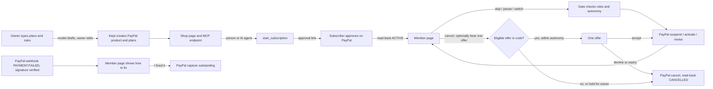

# Kept flow map

Written 10 Nov 2026 from the code on `main` (commit 8b516fc) and a walk of https://pph-kept.onrender.com. File references are to `src/`.

## Personas

| Persona | Gets in by | What they do |
|---|---|---|
| Shop owner | `/login` → demo owner button (demo mode) or owner key; optional Log in with PayPal (off) | Sets up plans and rules in plain words, watches renewals, approves held money moves, reads fairness, compliance and evidence pages |
| Subscriber (a person) | The shop page `/s/:slug`, then their own member page `/manage/:ref` (the ref is the bearer secret) | Subscribes through PayPal, skips, pauses, resumes, switches plan, cancels in one step, optionally hears one offer, fixes a failed payment |
| Subscriber's AI agent | MCP at `/mcp` (directory), `/s/:slug/mcp` (one shop); REST at `/api/v1` | The same operations as the subscriber, with `X-Agent-Id`; returns PayPal approval links for the human |
| Owner's own agent | MCP at `/owner/mcp` with `Authorization: Bearer <owner key>` (read-only) | shop_summary, ask, list_subscribers, recent_events, recent_runs, search_transactions, compliance_scorecard, fairness, pending_approvals |
| Judge | `/judge` (six beats), `/judge/reset` | Reads the story; links into owner pages |
| Background | Worker (`worker.ts`, jobs table) and daily cron (`cron-main.ts`) | Scheduled resumes, discount reverts, offer expiry, cancel retries, payment follow-ups, renewal reminders, reconcile |

## Screens (before the redesign)

Public: `/` landing with persona cards, `/login`, `/s/:slug` shop page, `/s/:slug/llms.txt`, `/llms.txt`, `/skill.md`, `/agents`, `/judge`.
Subscriber: `/manage/:ref`, `/manage/:ref/check` (scam check), `/r/:ref` (PayPal return; reads back and redirects).
Owner onboarding: `/onboard` → `/onboard/plans` → preview → create → `/onboard/rules` → preview (with replay) → approve → `/onboard/done`.
Owner app: `/dashboard` (Today: needs-you, ask, Bryntum calendar, members, reasons, offers, activity, rules, plans, connections), `/dashboard/guard` (approvals, autonomy, backtest, kill switches, passkey, audit), `/dashboard/compliance`, `/dashboard/money` (transactions, invoices, negative tests, webhook simulator), `/dashboard/channels`, `/dashboard/safety` (+ model card), `/dashboard/traces`, `/trace/:id`, `/dashboard/eval`, `/dashboard/evidence`.

## State changes

Subscriber `status` mirrors PayPal (`APPROVAL_PENDING`, `ACTIVE`, `SUSPENDED`, `CANCELLED`); Kept's own `kept_state` adds `payment_failed`, `cancel_pending`, `switch_pending…`, `unconfirmed`. **Only a PayPal read-back changes `status`** (`executor.ts` reads the subscription after every write).

| Trigger | Code | PayPal call | Amount | Who approves |
|---|---|---|---|---|
| Owner approves plans | `svc.createPlans` | Catalog Products create (once per shop), Billing Plans create | Owner-typed price, parsed by model or rules, shown back and edited before create | Owner (button) |
| Owner approves rules with a discount | `svc.approveRules` | Billing Plans create for each discount plan | Price × (1 − percent) computed in code (`discountedPrice`) | Owner |
| Subscribe (web or agent) | `svc.startSubscription` | Subscriptions create → approval link | Plan price | The subscriber on PayPal's page |
| Return from PayPal | `/r/:ref` → `svc.syncSubscription` | Subscriptions get; transactions | — | — |
| Skip next | `svc.skipNext` | Subscriptions suspend; job `reactivate` 1 h after the skipped billing date | No charge for the skipped cycle | Subscriber/agent within rules; gate checks autonomy |
| Pause N cycles | `svc.pause` | suspend, scheduled activate | — | Same |
| Resume | `svc.resume` | activate | — | Same |
| Switch plan | `svc.switchPlan` | Subscriptions revise; PayPal may return a consent link | New plan price from next cycle | Subscriber on PayPal's page when PayPal asks |
| Cancel | `svc.requestCancel` → `cancelDurably` | Subscriptions cancel; retries with the same request id until read-back is CANCELLED | — | Never held: a cancel is always allowed by the gate |
| Cancel with `hear_offer` | Eligibility in code (`policy/eligibility.ts`), brain picks one id, gate checks autonomy and compliance | None until accepted | Offer value computed in code | Subscriber accepts or declines; held offers go to the owner |
| Accept offer | `svc.respondToOffer` | revise (discount or switch) or suspend (pause/skip); job reverts the discount | Discount plan price | Subscriber (and PayPal consent if needed) |
| Failed renewal | Verified `BILLING.SUBSCRIPTION.PAYMENT.FAILED` webhook, or the demo button | — | Outstanding balance from PayPal | — |
| "I fixed it" | `svc.paymentFixed` | Subscriptions capture (outstanding) | Outstanding balance read from PayPal | Subscriber click is their own approval; agent captures above the threshold are held |
| Invoice outstanding | `svc.invoiceOutstanding` | Invoicing v2 create + send | Outstanding balance | Owner |
| Reconcile | `svc.reconcileMerchant` (daily cron, button) | Subscriptions get + transactions for every live subscription | — | — |

## AI calls

All go through `ai/provider.ts` (OpenAI Responses API, strict JSON schema, forbidden money/PayPal-id fields checked at call time, every call logged in `ai_calls` with cost and latency; falls back to the deterministic rules brain `brain/local.ts` per call).

| Purpose | Model (live) | Input | Output | What code does with it |
|---|---|---|---|---|
| `draft_plans` | gpt-5.5 | Owner's plain-words plans | names, interval, a price **quote** from the owner's text | Grounds each price to the owner's text, shows the draft for editing; only the edited form values go to PayPal |
| `draft_rules` | gpt-5.5 | Owner's plain-words rules | Structured rules | `validateRules`; `neverBlockCancel` forced true; compliance scorecard refuses forbidden rules; replay against past cancellations |
| `classify_reason` | gpt-5.4-mini | Cancel reason after instruction lines are quarantined | One category | Feeds eligibility (quality reasons get no discount) |
| `word_offer` | gpt-5.4-mini | The offer code already chose | Wording | Checked for invented numbers; code's terms win |
| `explain_failure` | gpt-5.4-mini | Failed-payment facts | Plain-words notice | Shown on the member page only |
| `owner_answer` | gpt-5.4-mini | Question + shop stats JSON | Answer ≤ 90 words | Displayed; never acts |

## Message channels

Telegram (live bot token and webhook secret are set on Render): owners get held approvals with Approve/Decline; members get renewal reminders and failed-payment notes with buttons; linking uses a one-time code. WhatsApp: code present, no token set. Web push: VAPID keys set on Render; subscription from the browser. `/dashboard/channels` has a simulator.

## Main journey

